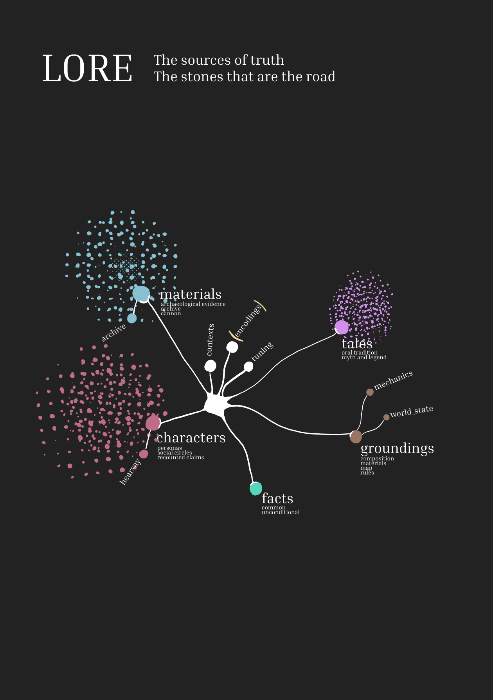
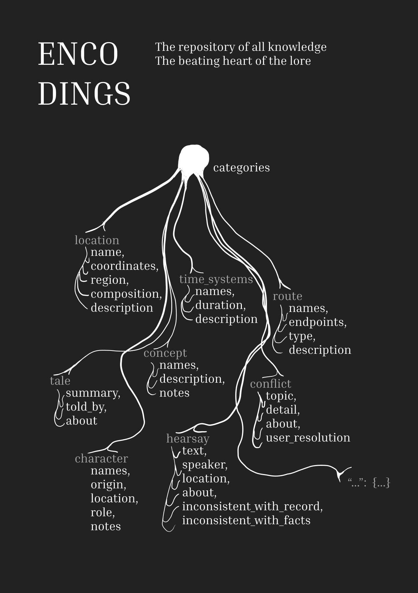
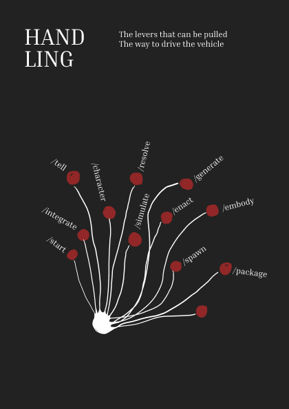

<div align="center">

</div>

# Part I. Concept


## Introduction

Provenance is a storytelling and world-building engine for authors. Starting from a hand-authored seed, it grows a fictional society via procedural and semantic generation based on a foundational corpus of knowledge that mutates through deterministic rulesets, user interaction and subjectified iteration.

Characters, played by constrained agents, meet, talk and interpret one another, develop story arcs, reproduce and eventually die; with each of these things leaving a trace in the corpus that later characters draw and base what they know about the world, and thus what they say about it, on.

It is both a tool for authors and an experiment in agent-based constrained social simulation. 

Pre-alpha. Currently only text-based, but ships an embodiment layer (in progress) to instantiate characters in Minecraft. GUI planned but not built yet.

## Why

I started this project because I wanted to infuse life into the lore of my 14 year old Minecraft world. I wanted the world to feel less liminal, and so I wanted to populate it with NPCs that I could interact with who could tell me stories about the world I was in. But not any random or sloppified story. but a real story; a story connected to what I had built, when and why. 

LLMs can generate dialog and entire worlds that seem plausible very easily, but the output is at best generic or at worst downright plagiarized. Throughout the years, the lore I had had accumulated in scattered notes, maps, some Minecraft books or merely in my and my friends' imaginations, and as such it was hard to make it stick to it. So I was curious to know what would happen if I encoded this knowledge and gave portions of it to agents as the only thing they knew about the world, while putting them in a simple parametrized world where they could interact with one another, while feeding back their interactions into the knowledge pool that others would draw upon later in a recursive semantic unraveling.

The idea of simulating a society solely (or mainly) via the conversations characters have with one another comes from Niklas Luhmann's theory of society, wherein society is analysed purely from the lens of its systems of communication, which are in turn conceived as self-reproducing, autopoietic entities. In this view, complexity is made sense of imperfectly, and it's in this process that meaning is created.

The simulation architecture resembles other systems that attempt something similar following different approaches, such as Dwarf Fortress and Talk of the Town. Other parts of the system are inspired by Lévi-Strauss' mythemes and Bourdieu's concept of capitals. 

## Objectives

To sustain a living substratum of lore that reads immersive and organic, and that users can explore and participate in. 

  Immersive insofar as it is responsive and unpredictable enough to be experienced as natural, consequential, real, alive.
  
  Organic insofar as it's not mechanic: varied and imperfect, shaped by its environment and with the capacity to shape it back, emergent.

Organic has two sides. Structurally, the world produces its own components: it reproduces, mutates and exchanges with its environment. Perceived, it reads as alive. Immersion is what you feel when you act inside a world that reads as alive.

Under both, two constraints: it should run on any model and stay lean enough in tokens to work at the scale a culture needs.

## Design Principles

Negative space sustains the foundations of the world. The lore is accessible through what characters say about it. Every claim that is made presumes the existence of what is spoken about, at least in so far as it is credible by who interprets it given its provenance. 

All world knowledge is self-contained. Agents only know what the characters they voice know, who only know a portion of what is to know in and about the world. All new added knowledge to the world comes from author input and from knowledge mutations that results from it passing through characters interactions.

Perfection is not the goal, slop is the enemy. World knowledge may be contradictory, incomplete and overlapping. The soul of the world sprouts from in between the contents' imperfections, not from a statistically probable soul-like shape.

## Testability

As an experiment on the capacities and limits of agentic workflows to generate an experience of immersion and organicity, the project objectives can be considered achieved if the following is satisfied:

The lore is measurably organic and perceived as alive.

(1) Structural organicity is operationalized as the world lore reproducing its own transforming components allowing for both drifting and traceability. New characters, claims and relationships appear, with every retelling reinterpreting what it retells, and with each change being able to be traced back to something already in the record. 

It is measured on the traces that interpretation leaves as it advances:

- **Derivation**: how much of a claim traces back to an existing entry, and how much floats free of it. Content anchored to nothing is counted as slop.
- **Drift**: how far a claim travels across retellings and generations.
- **Divergence**: how far apart the accounts of one event are between characters with different criteria, and between runs of the same seed.

Underneath sits a floor, conformance: outcomes checked against the stated odds and a few invariants, so that a failure of the dice is not mistaken for a failure of the world. And one control, a pair of runs with the same seed and the same dice, so that whatever differs between them is the agent layer alone.

(2) Perceived organicity and immersion are accorded by users satisfaction, measured in standardized scale with set of questions to compare across runs and configuration settings.


| Instrument | Asks |
|---|---|
| `conformance_report.py` | Did each stochastic script land at its stated odds, and did every draw go through the audit log? |
| `measure_derivation.py` | What share of hearsay references resolve to a real entry, and of experience entries carry a `produced_by` back to their scene? |
| `measure_drift.py` | How far does a claim move per retelling? |
| `measure_divergence.py` | Same commit, same RNG seed, two runs: dice are identical, so what differs is the agent layer |
| `record_tasting.py` (`/taste`) | A person scores 0 to 10: legibility, aliveness, curiosity, specificity |
| `simulate_token_usage.py` | What did each pass cost? |


## The parts of the system [Work in Progress]

### Seeds

Content provided by author and encoded by agent. To be conceptualized as the *archaeological record* of the world: books, fragments, maps, lists. May come in any format that an agent can digest. The agent is instructed to archive the material as an archaeologist logging in an artifact in a museum. No inference on materials is made. Can be fed at any point, but requires an initial seed to get the system running.

### Lore

<p align="center">
  
</p>

*The sources of truth, "the stones that are the road". Materials, characters, tales, facts and groundings each feed the hub; contexts, tuning and, bracketed, encodings sit beside it.*

- **Material:** excavated documents (`/integrate`), never edited, contradictions kept.
- **Tales:** myth, legend or plain fact, told by me (`/tell`). Who told the system is recorded apart from who told it in-world.
- **Characters:** what they say becomes hearsay.
- **Facts:** two so far (a life ends; everyone wants theirs to have been worthwhile). Never sampled, known in full by everyone, never contestable; the floor a character's criterion stands on.
- **Groundings:** true whether or not anyone knows it (rules, the physical state of the world). Read live and gated by a character's routines and where they've been.

`contexts.json` holds five place-type templates; `tuning.json` holds every knob.

### Encodings

<p align="center">
  
</p>

*The repository of all knowledge, "the beating heart of the lore": location, time_systems, route, concept, conflict, tale, character, hearsay, and room for more.*

`_lore/encodings.json` is where the sources become one queryable record. Related entries point at each other through named fields (`character.origin`, `route.endpoints`), not a generic references list, which would turn "sample one character" into "sample their whole neighborhood". Only the claim-shaped categories (hearsay, tale, conflict) carry an `about`. Disagreements sit in `conflict` until I settle them through `/resolve`.

### Characters

<!-- blueprint: characters (pending) -->

A character is one file whose parts move at different speeds. `knowledge.education` is a random sample of the record, frozen at creation, which is why they're unevenly gapped. `knowledge.experience` only grows. `criterion` is what they'd count as a *wasted* life, anchored to one concrete case; it changes only when a *shock* (a claim or experience touching the anchor) lands and they reject it, reinterpret it or break. *Drift* only makes them more or less susceptible. Most scenes change nothing.

Each also has a secret lifespan, kept out of the file the model reads, so they can only be told "early", "established" or "late". On a death, relations are told for certain, about 30% of the wider circle hears at once, and everyone else finds out the way people do.

**Routines and arcs.** A routine is a place-type a character spends time in (market, temple, commons, home, route) with a weight; two to four, hand-authored, and one is rolled each pass. An arc is the one concrete project they're after: what it's about, which `provides` tags it needs met, a premise concrete enough to tell when it's done, and a resolution that starts "ongoing" and moves by tally (advance, stall, reverse, transform, resolve; the default threshold is 3).

### State transformation

<p align="center">
  
</p>

*Knowledge pool appendage and mutation; myth formation. Pink arrows: author input. Blue: the record and the character. Green: what a scene writes (to hearsay, to the character, to tales). Brown: groundings.*

A scene writes back in three places. What was said becomes hearsay and folds into the record. What happened to the character goes on their file. Births, deaths and finished arcs become tales. All three re-enter the pool someone else samples from; that's what I mean by drift.

Every claim keeps where it came from. `build_source_index.py` links a claim's `about` references to the entries they name, tagged honestly as hearsay or tale; registering that something exists never upgrades how well evidenced it is. When a character retells a claim, a 50/50 coin (`lineage_coin.py`) decides whether it stays traceable ("I heard it from...") or turns into untraceable oral lore ("they say..."). References that don't match are never guessed at: near-spellings are grouped provisionally and logged as a conflict only I resolve.

### Handling

<p align="center">
  
</p>

*The levers that can be pulled; the way to drive the vehicle. One root, one line out to each skill: eleven labelled (/start, /integrate, /tell, /character, /resolve, /simulate, /enact, /generate, /embody, /spawn, /package) and one node without a label.*

Two kinds of lever: grow the record, or put it in motion. The walk-through is "Getting started" in Part II.

### Simulation

<!-- blueprint: simulation process (pending) -->

`/simulate` runs the world without me. A pass draws one living character, uniformly; who else is involved is *discovered*, not assigned. They roll to survive or pursue their arc. Surviving is their own routine roll, and the pass ends. Pursuing means finding a place whose context can supply the arc's need, travelling there if it isn't local, and rolling whether anyone useful is present (a missed connection is a real outcome). If someone is, they roll their own routine, and a payment gate against the character's own provisions decides whether the pass was motivated at all. Only a pass that gets through produces a scene, and its outcome is rolled *before* it's written; the model dramatizes something already decided.

**Survival.** Each location has a shared provisions pool. A character eats from it if it can afford them, working adds to it and chasing an arc costs extra energy, so a town can run dry and a character can starve. Energy at zero is a death, separate from the lifespan clock. Characters also carry their own provisions, which is what an arc is paid for from; that children inherit them is only a sketch in `TODO.md`.

**The Ollama enacter.** Writing the scene is the one judgment step. It goes to a Claude subagent, or to a local Ollama model (`qwen2.5:14b` by default) through `enact_via_ollama.py`, which demands strict JSON (scene lines, hearsay claims) so a small model can't wander into free text, and reads a fixed preamble of writing rules fresh on every call. The orchestrating session does everything else itself, which is what makes the local path cheap.

Runs live in disposable git worktrees that are never merged back on their own. Known gaps: the rivalry follow-up (`leads`) has no call site in the current model, `social_circle` is a field nothing writes to, and *reflection* (a character processing alone) is undesigned.

### Testing

<!-- blueprint: testing process (pending) -->

A run that's testing the design (not a casual showcase) writes a manifest (population, pass count, starting commit, RNG seed if any) and a draw-audit log. The instruments above read those two files, `/simulate`'s closing step runs them and asks for a tasting, and a templated entry lands in `LAB_REPORT.md`; the qualitative sections I still write by hand.

## Glossary

- **seed:** the minimum inputs a world grows from.
- **material / tale / fact / grounding:** the four kinds of source, plus characters; see Lore.
- **encodings:** the one structured record the sources feed.
- **hearsay:** a claim made inside a scene, kept with who said it and where.
- **provenance:** where a claim came from, kept with it.
- **criterion:** what a character would count as a wasted life; **anchor:** the concrete case it's derived against.
- **shock / drift:** the one way a criterion moves / what makes a character more or less susceptible.
- **routine / arc:** where a character spends time / the project they're pursuing.
- **context:** a place-type template; **provides / needs:** what a context supplies / what an arc requires.
- **pass:** one tick of `/simulate`.
- **corpus:** the lore content of a world, kept on its own branch.
- **slop:** plausible content grounded in nothing.

---

# Part II. Technical [In Continuous Development]


## Getting started

New to this repo? Run `/start` for a live welcome banner (what's already in this copy of the world,
plus the two doors below) — or read this section once and skip it after. Everything the system does
falls into one of two kinds: growing the raw record the world draws from, and setting what's already
there into motion.

**Growing the record**

- **Material** (`/integrate`) — archaeological findings: knowledge sourced from something that
  actually exists as evidence — a book, a map, a photograph of a construction, any document, in
  whatever file format it happens to arrive in (PNG, JPG, PDF, XLSX, ...). Drop the file in
  `_lore/material/`, then run `/integrate` to analyse it into `context.md`/`encodings.json`/
  `unknowns.md`. Not a one-time dump — the well keeps getting fed for as long as the project runs.
- **Character** (`/character`) — hand-author a person into the world directly: name, origin, backstory,
  and a knowledge sample. Criterion and lifespan are then *derived* from those choices, not chosen
  separately — a consequence of what's already been authored, never invented on their own.
- **Tell** (`/tell`) — knowledge with no material trace behind it: myth, legend, oral story, told
  directly by you to the system rather than excavated from a document or spoken by a character. Its
  own epistemological layer, distinct from both the objective record and from hearsay.

**Putting it in motion**

- **Enact** (`/enact`, or `/enact-embody` to also put it in the game) — one live scene, one
  instantiation, played turn by turn against the player or another character.
- **Simulate** (`/simulate`) — many enacted scenes chained across an existing population,
  unattended — a trail through the world's history, not mechanical.
- **Generate** (`/generate`) — the odd one out: mechanical and scene-less, fast-forwarding the
  population itself (births, arcs) with no prose at all, to grow a big starting cast before a
  showcase run.

Pick any door — they combine in any order, and the record only grows richer for it.

## Index

**Starting a new session? Read Part I above plus §0–§2 first — that's the compulsory minimum for
orientation.** Everything past that, read only the section(s) the task at hand actually needs.

- [Getting started](#getting-started) — brand new to this repo? The two doors in: growing the record
  vs. putting it in motion. Run `/start` for a live version of this.

- [§0 System architecture](#0-system-architecture) — the lore engine, then the current embodiment stack built on it; start here every session
  - [Tier 1 — Content](#tier-1--content)
  - [Simulating and evaluating the lore](#simulating-and-evaluating-the-lore)
  - [Tier 2 — Handlers](#tier-2--handlers)
  - [Tier 3 — Shipping](#tier-3--shipping)
- [§1 Folder structure](#1-folder-structure) — compulsory: the literal `_lore/`/`data/`/`_npcs/` tree
- [§2 Core concepts](#2-core-concepts) — compulsory: Fact / Criterion / Lifespan / Death first, then NPC / Dialog / Action / routine pause-resume for the current embodiment backend
- [§3 Writing lore through enactment](#3-writing-lore-through-enactment) — the manual walkthrough (`/enact` automates Steps 1–2, `/embody` Steps 3–4)
  - [Step 1 — Bound the character's knowledge](#step-1--bound-the-characters-knowledge)
  - [Step 2 — Enact the conversation](#step-2--enact-the-conversation)
  - [Step 3 — Convert the transcript into a Blabber dialog](#step-3--convert-the-transcript-into-a-blabber-dialog)
  - [Step 4 — Register it](#step-4--register-it)
- [§4 Where design decisions live](#4-where-design-decisions-live) — why lore/story content isn't in this file, and where the standing test of the whole system is tracked

**Embodiment backend: Minecraft.** Everything from §5 on is specific to the system's current
embodiment target, not to the lore engine itself.

- [§5 Building a new NPC, start to finish](#5-building-a-new-npc-start-to-finish) — the manual walkthrough (`/spawn` automates this)
  - [Step 1 — Register it](#step-1--register-it)
  - [Step 2 — Create the spawn function](#step-2--create-the-spawn-function)
  - [Step 3 — Write the dialog](#step-3--write-the-dialog)
  - [Step 4 — Spawn it in-game](#step-4--spawn-it-in-game)
  - [Step 5 — Capture its UUID](#step-5--capture-its-uuid)
  - [Step 6 — Set up routine pause/resume](#step-6--set-up-routine-pauseresume-only-if-movement-isnt-none)
- [§6 Routine pause/resume (every NPC)](#6-routine-pauseresume-every-npc) — read for every NPC, including stationary (`NONE`) ones
- [§7 Capturing NPC UUIDs](#7-capturing-npc-uuids) — the `scripts/minecraft/update_uuids.py` workflow
- [§8 Reference](#8-reference) — lookup tables: scoreboard objectives, entity tags, movement modes, Blabber selectors, command cheat sheet

---

## 0. System architecture

The system splits into two halves. The **lore engine** — Tier 1 below, plus how it's simulated and
evaluated — is the actual product: embodiment-agnostic, generating and evolving a culture on its own
terms. **Embodiment** is how a run of that engine gets surfaced somewhere live; today that's one
backend, Minecraft, built as a dependency stack on top of Tier 1:

```
3. Shipping   Datapack: data/luminacion/ — functions, predicates, tags, dialogues Minecraft loads
              Resource pack: gestures (EMF/Iris model overrides), localization, custom sounds
        ↑                    what a run of the engine becomes, live in the current backend
2. Handlers   Skills (/character, /enact, /embody, /spawn, /integrate, /simulate, ...) driving
              scripts (scripts/lore/, scripts/minecraft/) through shared supporting patterns:
              _npcs/templates/, _npcs/actions/registry.json (_action_templates), gesture dispatch
        ↑                    the process that shapes content into shippable material
1. Content    _lore/ — material → analysis → encodings.json, characters, tales, facts
                                   the sources of truth, inert until a handler acts on them
```

A different or additional embodiment backend would replace Tier 3 without touching Tiers 1–2 or
the simulation/evaluation tooling described next.

### Tier 1 — Content

- **`_lore/`** — the raw material and its analysis, plus two further sources of truth: one told
  directly by the user, and one (`facts/`) that is universal and never sampled:
  - `_lore/material/` — source artifacts as uploaded: screenshots of in-game books, maps,
    spreadsheets, documents, in whatever file format they arrive in. Treated as excavated primary
    sources — never edited, only read.
  - `_lore/material/_context.md` — one section per material artifact, transcribing only what that
    specific source says or shows, with no cross-source reconciliation. Contradictions between
    sources are noted here, not resolved. Lives inside `material/` itself, the only analysis output
    that's source-specific rather than cross-cutting.
  - `_lore/encodings.json` — the central, structured, queryable form of the record: `time_systems`,
    `locations`, `routes`, `characters`, `concepts`, `conflicts` (cross-source disagreements, each with
    a `user_resolution` once settled), `tales`, and `hearsay` (claims made *in* dialogues — §3 Step 7).
    This is what `scripts/lore/sample_lore_knowledge.py` draws an NPC's knowledge pool from. Sits at `_lore/`
    root since every source type writes into it — it's the hub.
  - `_lore/unknowns.md` — gaps and open questions that material, tale, and hearsay all feed (a claim can
    surface a genuine gap the objective record has never addressed, distinct from `inconsistent_with_record`,
    which flags a claim that actively contradicts something already on record), plus a log of which
    have since been resolved by the user. Sits at `_lore/` root alongside `encodings.json` since it's
    cross-cutting, not specific to any one source folder.
  - `_lore/contexts.json` — the place-type templates `/simulate`'s routine/arc mechanism draws on, authored once here and shared by every routine tagged with that context: five today (`market`, `temple`, `commons`, `home`, `route`), each with a `texture`, a `provides` list (which arc needs it can satisfy) and a `grounding_provides` list (which `grounding/mechanics.json` entries a character with that routine knows). A minimal starting set, meant to grow by hand.
  - `_lore/tuning.json` — every tunable odds value, threshold, cooldown and the lifespan range, read by the scripts through `scripts/lore/tuning.py` instead of hardcoded in each; every value in it is a first guess, untuned by any run.
  - `_lore/characters/` — one JSON file per character (`<key>.json`, key = lowercased, slugified
    name), the complete lore record for who they are: `name` (canonical — the one place a character's
    name is decided), `origin` (fixed birthplace), `location` (current whereabouts), `backstory`,
    `knowledge` (`education`/`experience`), `criterion`, and
    `life` (`lived`/`deceased`). Has no embodiment-facing field at all — a character can live here
    fully developed with no in-game body. `/character` and `/enact` are the only writers.
    `_lore/characters/lifespans.json` sits beside them, holding each character's secret total span
    (see **Lifespan** in §2). `_lore/characters/hearsay.md` is the human-readable counterpart to
    `encodings.json`'s `hearsay` array: what's been said, by whom, where, and whether it checked out
    against the record. `_template.json` is the blank shape for a new character file.
  - **Character identity.** Every character's `name` must be unique against every character file ever
    created, living or deceased — checked by `scripts/lore/check_character_name.py`, the single shared
    enforcement point `/character` and `/enact` both call before treating a name as new. A namesake is
    still fine (`"Farlis Gorfalis"` alongside an existing `"Farlis"`) since the two slugify
    differently; what's not allowed is two files slugifying to the same key.
  - `_lore/tales/` — a third source of truth, populated by `/tell`: things told directly by the user,
    the world's author — narrated as a story or stated plainly as a fact now known — one file per
    entry (`<slug>.md`). Unlike hearsay, a tale **is** folded into the objective arrays above (via a
    `tale:<id>` source tag), never overwriting an existing entry. See `_lore/tales/_index.md` and
    `encodings.json`'s `tales` category. (Not to be confused with `_lore/facts/` below — a tale is
    lore, and gets sampled like all lore.)
  - `_lore/tales/_authors.md` — not itself a source of truth, and not lore at all: real-world
    recordkeeping only, tracking which real user told the system each tale (`responsible`, mandatory)
    and when. Distinct from a tale's `told_by` (in-world credit, optional, which *is* lore and lives in
    `encodings.json`) — `responsible` answers who entered the record in the real world, has no
    in-fiction meaning, and is walled off from `encodings.json` and `scripts/lore/sample_lore_knowledge.py`'s
    pool on purpose, the same way `_lore/facts/` is. A plain markdown table, living beside the tales it
    tracks.
  - `_lore/facts/` — a fourth source of truth, and the only one that is **never sampled**. The handful
    of things true of being a person in this world at all: that life ends, and that everyone wants
    theirs to have been worthwhile. Every character knows every fact in full, from creation,
    regardless of their education percentage — so facts live in their own `facts.json`, deliberately
    outside `encodings.json`, and must never be folded into it (`sample_lore_knowledge.py` raises if
    they are). Unlike every other category, a fact has no provenance, cannot be attributed, and
    cannot be dismissed: it's the floor a character's contestable criterion stands on, not part of
    the argument. Loaded unconditionally by `/enact` for every character in every scene. See
    `_lore/facts/_index.md`.
  - `_lore/facts/_authors.md` — the same real-world recordkeeping as `_lore/tales/_authors.md`, for
    consistency, even though facts are added rarely: which real user added each fact, and when. Facts
    have no in-world attribution at all, so unlike the tale version there's no `told_by` this file
    needs to stay distinct from - `responsible` is simply the only provenance a fact ever has.
  - `_lore/grounding/` — a fifth source of truth, added 2026-08-26: objective, "true regardless of
    anyone's knowledge" content, distinct from a fact (true of being a person at all) and from
    material (a claim that may or may not be true - see the folder's own Troy distinction).
    `mechanics.json` holds embodiment rules (tagged `embodiment: "minecraft"` so a future backend
    only swaps this content); `world_state.json` holds the world's actual physical state, sourced
    from an external region-file/machine-vision pipeline outside this repo (empty until that pipeline
    delivers). Neither is sampled by `sample_lore_knowledge.py` or folded into `encodings.json` -
    `scripts/lore/sample_grounding.py` computes access live instead, gated by a character's own
    routine contexts (`_lore/contexts.json`'s `grounding_provides`) and routine locations, never
    randomly. Unlike a fact, grounding *can* be attributed - a character knows it first-hand, and
    `build_source_index.py` indexes it as its own sourced category. See `_lore/grounding/_index.md`.

### Simulating and evaluating the lore

`/simulate` (Tier 2, below) is the mechanism; the pieces below sit alongside it, reading the lore engine's
output rather than feeding it, and aren't part of the Tier 1–3 dependency stack at all:

- **`LAB_REPORT.md`** — the persistent, cross-run record of whether the system's design actually
  works, kept deliberately outside any worktree so it survives past any single run or conversation.
  It states the standing objective (does drift over many interactions read as genuinely emergent,
  with real material consequence, rather than a repeated pattern or a smooth model-biased
  convergence?), the methodology for judging a run against that objective, and a dated run log.
  `scripts/lore/simulate_record_run.py` writes the templated entry automatically at the end of every
  run; the qualitative sections (what worked, what didn't, open questions) still get filled in by
  hand. See also §4.
- **The test suite (`scripts/test/`)** — read-only instruments that measure a run rather than
  changing anything it produces, all driven off `scripts/lore/rng_context.py` (a per-run draw-audit
  log every stochastic script call gets recorded into) and `scripts/lore/run_manifest.py` (the
  run's own machine-readable starting state — pool, pass count, and, if the run opted in, an RNG
  seed). Wired into `/simulate` Step 4 as a closing block, run only on a run explicitly testing or
  extending the design, not a casual showcase trail (the design contract these
  instruments cite, `TESTING_BRIEF.md`, lives outside this repo):
  - `conformance_report.py` — did every stochastic script call actually go through the seeded/logged
    path it was supposed to, rather than an untracked `random` call slipping past the audit.
  - `measure_derivation.py` — what fraction of `knowledge.experience`/`grounded_experience` entries
    carry `produced_by` provenance (which scene, which pass) back to an actual `/enact`/`/simulate`
    write, rather than reading as content nobody can trace.
  - `measure_divergence.py` — for the isolation experiment specifically: given the same starting
    commit and the same `--seed`, do two independent runs actually produce identical mechanical
    records, isolating whatever *does* differ (scene prose, judgment calls) to the agent layer alone.
  - `measure_drift.py` — whether a population's criteria/arcs/relationships are moving in a way that
    reads as genuine drift over the run, not stalled or oscillating in place.
  - `record_tasting.py` — records one rater's immersion-tasting scores (legibility, aliveness,
    curiosity, specificity, 0–10 each) against a run's manifest; `.claude/skills/taste/SKILL.md`
    (`/taste`) is the standalone command that asks the four questions, also folded inline into
    `/simulate` Step 4 on a design-testing run so the first tasting doesn't wait for a separate
    invocation.
  - `simulate_token_usage.py` — reads Claude Code's own session transcript for a run's actual
    per-turn token cost, so cost is comparable across dispatch models rather than only guessed at.
- **`graphs/graphifyish/`** — `scripts/graphs/graphifyish.py`'s output: a standalone
  `graphifyish.html` visualizing three graphs built from the repo's own live sources of truth (never
  hand-maintained except the concept graph's shape) — the **lore** graph (NPCs, dialogues, locations,
  concepts, characters, conflicts, routes, eras, tales, facts, wired by who lives where / says what /
  knows what / disputes what), the **structure** graph (the repo on disk, sized by bytes), and the
  **concept** graph (this section's own three-tier architecture, with live counts). Regenerate with
  `python scripts/graphs/graphifyish.py` (`--json` also dumps `graph.json`); `scripts/hooks/post-commit`
  does this automatically after every commit if installed.

### Tier 2 — Handlers

Skills and scripts: the process that reads Tier 1 content and shapes it into what Tier 3 ships.
Skills are the orchestration sub-layer — repeatable procedures invoked as slash commands, each one
answering to one shared rule stated once in `CLAUDE.md` rather than repeated per skill:
nothing gets decided silently. Scripts (`scripts/lore/`, `scripts/minecraft/`, `scripts/graphs/`) are
the mechanical sub-layer skills call into. Both split cleanly along the lore/Minecraft line that runs
through the whole system: `/character` and `/enact` are lore-only and know nothing of Minecraft, with
one narrow exception — `/enact` stages a scene's raw transcript at `_npcs/scenes/<id>.md`, purely so
`/embody` has something to read later. That's staging content for the shipping tier, not lore itself,
and `/enact` still never touches either registry or `data/`. `/embody` and `/spawn` only ever touch
`_npcs/`/`data/` and know nothing of lore.

- **Skills** (`.claude/skills/`):
  - **`/character`** (`character/SKILL.md`) — creates or maintains a character's file in
    `_lore/characters/<key>.json` on its own, without running a conversation: `name`, `origin`,
    `location`, `backstory`, knowledge sample, **criterion**, and **lifespan**. It owns the criterion model —
    Step 4 derives one, Step 5 rolls a lifespan, and Step 6 is the canonical reference for how a
    criterion changes. `/enact` points back at those rather than restating them. Purely lore-side: a
    character can be fully fleshed out here with no embodiment at all, and this skill never touches
    `_npcs/`.
  - **`/enact`** (`enact/SKILL.md`) — the atomic interaction: plays a character in a live conversation
    (against the player) or against another character, sampled from a bounded slice of the lore, then
    records what the scene did to that lore (hearsay, criterion, `life`) and saves the scene's raw
    transcript to `_npcs/scenes/<id>.md` so `/embody` can convert it later, even cold in a later
    session. Against another character, it additionally requires both participants to have
    `routines`+`arc` on file and runs a scripted mechanical layer (location, arc progress,
    reproduction, death legacy) before the scene is written — `/simulate` is nothing more than this
    run repeatedly over an automated pool. That transcript is the only thing this skill writes under
    `_npcs/` — it never writes a dialog file or touches either registry. See §3.
  - **`/embody`** (`embody/SKILL.md`) — takes a scene `/enact` played and puts it in the game: reads the
    transcript from `_npcs/scenes/<id>.md` (so this works cold, in a later session, exactly as well as
    right after `/enact` in the same conversation), converts it into a registered Blabber dialog, bakes
    its gestures itself (Step 3 — replaces a minority of the dialog's default `nod_up_down` states with
    an emotionally-matched gesture from the vocabulary in `GESTURES.md`), and registers the NPC(s) in
    `_npcs/npcs/registry.json` and the dialog in `_npcs/dialogs/registry.json`. This is the only place
    gestures get baked now — the earlier standalone `/bake_dialog` skill was retired once every dialog
    in the pack turned out to be produced by tooling rather than by hand, leaving no case for it to
    serve outside `/embody`.
  - **`/enact-embody`** (`enact-embody/SKILL.md`) — a thin orchestrator: runs `/enact` in full, then
    `/embody` in full, for the common case of wanting a scene played, recorded, and put in the game in
    one pass.
  - **`/spawn`** (`spawn/SKILL.md`) — builds a registered NPC's `spawn.mcfunction` (and every
    supporting function) from `_npcs/templates/`. See §5/§6.
  - **`/integrate`** (`integrate/SKILL.md`) — three independent passes: analyse newly-added
    `_lore/material/` files into `context.md`/`encodings.json`/`unknowns.md` per the conventions those
    files already establish (below); audit every dialogue under `data/luminacion/blabber/dialogues/`
    for a matching `hearsay.entries` record (§3 Step 7 — unconditional by rule, but easy to miss on a
    hand-written dialogue that skipped `/enact`); and check for drift between what's referenced
    elsewhere (registries, sampled knowledge, and `tales` `touches` refs) and what's actually recorded
    in `encodings.json`. Run whichever pass(es) fit the situation, not necessarily all three.
  - **`/resolve`** (`resolve/SKILL.md`) — surfaces one open item at a time, either an unresolved entry
    in `encodings.json`'s `conflicts` array or an open question in `_lore/unknowns.md`, with the full
    detail plus every other place in the record that mentions it, and writes a decision only on the
    user's own explicit call. Never suggests a resolution or infers one from source agreement. The only
    skill that ever sets a conflict's `user_resolution` field.
  - **`/tell`** (`tell/SKILL.md`) — records a tale the user tells directly, outside any excavated
    document or character's mouth — narrated as a story or stated plainly as a fact now known, both
    the same category — optionally credited to an in-world source (`told_by`), into `_lore/tales/` and
    `encodings.json`'s `tales` category. Real-world provenance (`responsible` — who told the system) is
    recorded separately, in `_lore/tales/_authors.md`, never in `encodings.json`.
  - **`/simulate`** (`simulate/SKILL.md`) — batch-runs many `/enact`-equivalent character-vs-character
    scenes across an existing population, unattended, inside a dedicated git worktree
    (`simulate_setup_worktree.py` creates it from `HEAD`, so it branches from the current lore state
    rather than a stale `origin/<default-branch>`; `worktree.baseRef: "head"` in settings does the
    same for `EnterWorktree`'s own `name`-based flow). For testing the enactment mechanism at scale, or producing a
    showcase trail of scenes, without risking the real files — the worktree stays on disk afterward
    for inspection and is never merged back automatically. Lore-only, same as `/enact`. The
    orchestrating session does every mechanical step itself, directly, script by script — drawing the first
    participant (`pick_pair.py`: one uniform draw; a second participant, if any, is discovered during
    the pass, and a pass that never finds one is recorded mechanically and gets no scene), the
    pre-scene mechanical block (`pass_prep.py`: the survive-or-arc roll, the routine/location roll or
    travel toward a place that can supply the arc's need, the missed-connection roll, the payment
    gate, then the contested/arc gate/outcome rolls against `_lore/contexts.json`, tallied toward
    advance/stall/reverse/transform/resolve, plus the survival apply) and, after the scene, every remaining write
    (`pass_apply.py`: `update_character.py` calls, energy-death check, reproduction, death legacy) —
    and dispatches a subagent for exactly one thing: writing the scene itself, from the mechanical
    JSON `pass_prep.py` already produced, with no tool access of its own. Two dispatch paths for that
    one call, chosen in Step 1: **Haiku/Sonnet/Opus** (the `Agent` tool, a Claude subagent) or
    **Local** (`scripts/lore/enact_via_ollama.py`, a plain script call to a locally-hosted Ollama
    model, no subagent involved) — `scripts/lore/simulate_driver.py` collapses the whole per-pass
    loop into one call for the Local path specifically, at real token-cost savings over a
    subagent-per-pass design. Reproduction (`roll_reproduction.py`/`generate_offspring.py`, a new
    character file with inherited knowledge and a birth tale) and an ongoing arc's needs
    (`suggest_arc_needs.py`, ranked by overlap with the character's own routine rather than left to
    whichever tag is easiest to reach for) are both mechanized the same way. A run can optionally
    pass `--seed` for reproducible, comparable runs (the isolation experiment — see the test suite
    above); whether the mechanism is actually producing good results, as opposed to just running, is
    tracked in `LAB_REPORT.md` — see below. **`/generate`**
    is a separate command for pregenerating a large multi-generation starting population quickly
    rather than a showcase trail of scenes: the same underlying mechanics (routines, arcs,
    reproduction, death) run as one script-driven pass loop with no scene-writing and no subagent
    per pass, deferring the two things that genuinely need a model's judgment (a child's name, a
    fresh arc's content) into a single batched subagent pass at the very end. See
    `.claude/skills/generate/SKILL.md`.
- **Supporting patterns** — reusable templates and registries every NPC/dialog is built from, so each
  new one doesn't reinvent structure — the shared material skills and scripts read from and write into:
  - `_npcs/templates/` — placeholder-filled `.mcfunction` patterns (`spawn.mcfunction`,
    `resume_routine.mcfunction`, `check_proximity.mcfunction`, `end_with_gift.mcfunction`, plus
    `paths/` and `states/` variants for roaming/multi-state NPCs) — copied per NPC, never called
    directly. See §1.
  - `data/luminacion/blabber/dialogues/_template_*.json` — the three dialog shapes (one-off, linear,
    branching). See §1/§5.
  - `_npcs/actions/registry.json`'s `_action_templates` — documents every right-click action pattern
    (`movement`, `give_item`, `blabber_dialog`, `routine_pause_resume`, `scripted_path`,
    `multi_state_npc`, `random_dialog`, `scoreboard_set`) with copy-paste command patterns and, for
    several, hard-won in-game debugging notes (why `/random` never resolves in this environment, why
    the pause/resume radii must differ).
  - **Gesture dispatch** — `data/luminacion/functions/npcs/_shared/gesture_<name>.mcfunction` (wave,
    point, bow, shrug, palms-up, scratch-head, laugh, jump, cross-arms, no, face-palm, flex-arm, plus
    left-arm mirror variants `wave_left`, `point_left`, and `scratch_head_left`) plus `gesture_clear.mcfunction`
    and the `nod_up_down`/`nod_left_right` family: datapack-side functions that trigger the
    resource-pack animations below via a tag + per-entity scoreboard countdown, ticked every game tick
    from `tick.mcfunction` via `gesture_tick.mcfunction`/`nod_tick.mcfunction` — each NPC's hold/beat
    timing is independent of every other NPC's. (Replaced an earlier
    `schedule function ... replace` design, which used one datapack-wide timer shared by every gesture
    and every nod; see TODO.md "Multi-NPC gesture/nod scheduling collision" for why that broke once
    more than one NPC could gesture/nod at a time.) They physically live under `data/luminacion/`
    (Tier 3, shipping) but belong here conceptually — templated dispatch for content that's actually
    defined one tier up.

### Tier 3 — Shipping

What a run of the engine becomes, live, in the current embodiment backend — built *from* Tiers 1–2
for a given NPC, and what a different or additional backend would replace wholesale. Split across two
Minecraft-mandated folders that are really one export:

**Datapack.** `data/luminacion/` — the pack Minecraft actually loads and calls: `functions/` (per-NPC and shared
`.mcfunction` files), `predicates/`, `tags/functions/` (load/tick hooks, the routine-tick registry),
and `blabber/dialogues/` (the written dialogs) — see §1 for the full folder breakdown and §5 for the
build sequence.

**Resource pack.** Custom client-side content shipped alongside the datapack, version-controlled in this repo's
`resourcepack/` folder (own `pack.mcmeta` + `assets/`, same idea as `data/` is to the datapack).
Currently:

- **Gestures** — 12 animated poses (plus left-arm mirror variants) for Taterzens NPCs and real
  players: a forked `player.jem`/`player_slim.jem` EMF/Iris override, each pose triggered by a
  `CustomModelData`-tagged invisible stick in the main hand, coexisting with the installed Fresh
  Animations + FA+Player pack. **All detail lives in `GESTURES.md`** — the per-gesture
  `CustomModelData` table, how to modify/call/test a pose, the elbow-joint rig, and the hard-won
  `.jem` lessons. Read that file when (and only when) working on gestures — it's reference
  material, not session orientation.
- **Localization** (planned) — `assets/luminacion/lang/*.json`, generated from dialogue files by a
  not-yet-written `scripts/extract_dialogue_lang.py`.
- **Custom sounds** (planned) — not yet started.

**Wiring: repo ↔ live pack.** `resourcepack/` in this repo *is* the pack — no build/copy/zip step
for local dev. The folder Minecraft actually reads, `resourcepacks/luminacion/`, is a Windows
directory junction pointing back at `resourcepack/` here, so edits apply instantly (reload with
`F3+T`, or a full restart if that doesn't pick it up). The full wiring rationale — why a junction,
and the separate not-yet-built distribution zip — is in `GESTURES.md`.
---

## 1. Folder structure

```
Provenance/
├── CLAUDE.md                          (the project's standing instructions to any agent in it)
├── CHRONICLE.md, TODO.md,
│   OPEN_QUESTIONS.md, SESSION_LOG.md  (landmark sessions / design backlog / unsettled design
│                                       questions / where work stopped — see Part I)
├── GESTURES.md                        (the gesture rig's reference — §0 Tier 3)
├── assets/blueprints/                 (the drawings Part I embeds)
├── diagrams/                          (gen_simulate_pass.py + simulate-pass.html, a pass diagram)
├── .claude/                           (VOICE.md, settings.json, hooks/, and skills/ — one folder
│                                       per slash command)
├── LAB_REPORT.md                      (the standing test of the whole system — read before a
│                                       design-testing /simulate run; see §0)
├── _lore/                             (the lore engine's sources of truth)
│   ├── encodings.json                 (the central record — every source type writes in here)
│   ├── unknowns.md                    (gaps — fed by material and tales, not hearsay)
│   ├── contexts.json                  (place-type templates for routines — see §0 Tier 1)
│   ├── tuning.json                    (every odds/threshold/cooldown the scripts read)
│   ├── material/                      (excavated primary sources — read-only)
│   │   └── _context.md                (per-source transcription, only this folder's concern)
│   ├── characters/                    (one file per character — the complete lore record)
│   │   ├── <key>.json                 (name, origin, location, backstory, knowledge, criterion, life)
│   │   ├── _template.json             (blank shape for a new character)
│   │   ├── _index.md                  (what a character file holds and why)
│   │   ├── lifespans.json             (SECRET — each character's total span; /enact never opens
│   │   │                               this file, ask scripts/lore/horizon.py instead)
│   │   └── hearsay.md                 (human-readable mirror of encodings.json's hearsay array)
│   ├── tales/                         (told directly by the user, story or plain stated fact — /tell,
│   │   │                               see _index.md)
│   │   └── _authors.md                (real-world recordkeeping only — who told the system each
│   │                                   tale, walled off from encodings.json; not lore)
│   ├── facts/                         (universal, NEVER sampled — facts.json + one .md per fact,
│   │   └── _authors.md                see _index.md; deliberately outside encodings.json)
│   └── grounding/                     (objective, access-gated, NOT sampled — mechanics.json +
│       └── _authors.md                world_state.json; see _index.md; outside encodings.json too)
├── graphs/
│   └── graphifyish/                   (scripts/graphs/graphifyish.py's output — graph.json + a standalone
│                                       graphifyish.html visualizing the lore/structure/concept graphs)
├── scripts/
│   ├── lore/                          (only ever touch _lore/ — no embodiment awareness; what's
│   │                                   listed here is a selection, the folder holds about 65 scripts)
│   │   ├── sample_lore_knowledge.py    (draws a character's education sample — §3 Step 1)
│   │   ├── sample_grounding.py        (computes a character's live-gated grounding access — see
│   │   │                               _lore/grounding/_index.md; never cached, never random)
│   │   ├── lineage_coin.py            (rolls traceable/untraceable when a hearsay claim is retold)
│   │   ├── check_character_name.py    (the shared name-uniqueness check /character and /enact both
│   │   │                               call before treating a name as a brand-new character)
│   │   ├── roll_lifespan.py           (rolls how many scenes a character has in them, 30–60 —
│   │   │                               written to lifespans.json, never to the character's own file)
│   │   ├── horizon.py                 (the only thing /enact may ask about a life's horizon —
│   │   │                               answers early/established/late, plus a post-scene-only
│   │   │                               ending: true/false, never the number)
│   │   ├── notify_death.py            (on a character's death, computes their "circle" and
│   │   │                               notifies relations in full, samples 30% of the rest)
│   │   ├── enact_via_ollama.py        (/simulate's Local dispatch path — a locally-hosted Ollama
│   │   │                               model plays one pass's scene, no Agent tool involved)
│   │   ├── enact_preamble.md          (the fixed writing-rules preamble enact_via_ollama.py reads
│   │   │                               fresh every call — never composed or edited per-pass)
│   │   ├── simulate_driver.py         (collapses /simulate's whole per-pass loop into one call,
│   │   │                               for the Local dispatch path specifically)
│   │   ├── rng_context.py             (per-run draw-audit log every stochastic script call is
│   │   │                               recorded into, when the run opted into a --seed)
│   │   └── run_manifest.py            (a run's own machine-readable starting state — pool, pass
│   │                                   count, seed if any — scripts/test/ reads this back)
│   ├── test/                          (read-only instruments that measure a /simulate run, never
│   │   │                               change what it produces — see §0 "Simulating and evaluating
│   │   │                               the lore" for what each one checks)
│   │   ├── conformance_report.py
│   │   ├── measure_derivation.py
│   │   ├── measure_divergence.py
│   │   ├── measure_drift.py
│   │   ├── record_tasting.py          (backs /taste)
│   │   └── simulate_token_usage.py
│   ├── graphs/                        (builds the lore/structure/concept graphs)
│   │   ├── graphifyish.py             (writes into graphs/graphifyish/)
│   │   └── graphifyish_template.html  (the standalone page shell graphifyish.py fills in)
│   ├── hooks/
│   │   └── post-commit                (optional git hook — regenerates the graph after every commit)
│   └── minecraft/                     (only ever touch _npcs/ / data/ — embodiment backend only)
│       ├── validate_dialog.py         (structural checks on a Blabber dialogue JSON — /embody Step 1)
│       ├── update_uuids.py            (automates NPC UUID capture — see §7)
│       └── package.py                 (zips the datapack + resource pack for release — see /package)
│
│   ── everything below is the current embodiment backend (Minecraft) — §5 onward ──
│
├── pack.mcmeta
├── data/
│   ├── minecraft/tags/functions/
│   │   ├── load.json                  → calls luminacion:load
│   │   └── tick.json                  → calls luminacion:tick
│   └── luminacion/
│       ├── functions/
│       │   ├── load.mcfunction        (registers scoreboard objectives — runs once on load/reload)
│       │   ├── tick.mcfunction        (runs every tick — drives the routine pause/resume checks)
│       │   ├── admin/
│       │   │   └── export_npc_uuids.mcfunction   (auto-generated — see §7)
│       │   └── npcs/
│       │       ├── _shared/           (used by every NPC as-is — never copied)
│       │       │   ├── pause_routine.mcfunction
│       │       │   └── enter_dialog.mcfunction
│       │       └── <npc_key>/         (one real folder per NPC you've built)
│       ├── predicates/
│       ├── tags/functions/
│       │   └── npc_routine_tick.json  (registry: which NPCs get checked each tick)
│       └── blabber/
│           └── dialogues/
│               ├── _template_one_off.json
│               ├── _template_linear.json
│               └── _template_branching.json
├── _npcs/                             (embodiment-facing NPC data only — no lore field anywhere)
│   ├── npcs/registry.json             (master NPC data: display_name, taterzen_name, skin,
│   │                                   taterzen_uuid, spawn_position)
│   ├── dialogs/registry.json          (NPC key → dialog IDs)
│   ├── actions/registry.json          (NPC key → actions, plus reference templates for every action type)
│   ├── scenes/                        (raw scene transcripts — /enact Step 6 writes <scene_id>.md
│   │   │                               here, /embody Step 1 reads it; kept permanently even after
│   │   │                               conversion)
│   │   └── _template.md               (blank shape for a new scene file)
│   └── templates/                     (copy these into data/luminacion/functions/npcs/<npc_key>/ per NPC)
│       ├── spawn.mcfunction
│       ├── resume_routine.mcfunction
│       ├── check_proximity.mcfunction
│       ├── end_with_gift.mcfunction
│       ├── heal_path.mcfunction
│       ├── heal_skin.mcfunction
│       ├── paths/
│       │   └── select_path.mcfunction
│       └── states/
│           ├── roaming_state.mcfunction
│           └── stationary_state.mcfunction
└── resourcepack/                      (the resource pack — §0 Tier 3 Shipping; junctioned into
    │                                   resourcepacks/luminacion/ in the PrismLauncher instance)
    ├── pack.mcmeta
    └── assets/
        ├── luminacion/                (invisible gesture-marker item model + texture)
        └── minecraft/emf/cem/         (player.jem, player_slim.jem — the gesture pose overrides)
```

`_npcs/templates/` holds placeholder-filled patterns to copy — kept outside `data/` on purpose, since Minecraft
parses every `.mcfunction` file it finds under `data/`, and these still have unfilled `<placeholders>` that
aren't valid command syntax. The Blabber dialogue templates (`_template_one_off.json` etc.) are the
exception: they stay under `data/luminacion/blabber/dialogues/` since their placeholders live inside JSON
string values, which parse fine either way. Anything named `_shared` is called directly and never copied.

---

## 2. Core concepts

**Fact** — one of the handful of things true of being a person in this world at all, living in `_lore/facts/`. Every character knows every fact in full; facts are never sampled, never attributed, and never contestable. Currently two: life ends, and everyone wants theirs to have been worthwhile. Together they're the will to live. See §0 Tier 1 and `_lore/facts/_index.md`.

**Grounding** — objective content that's true regardless of whether any character knows it, living in `_lore/grounding/` (embodiment mechanics + world state). Unlike a fact, access is conditional, not universal: `scripts/lore/sample_grounding.py` computes it live from a character's own routines, never randomly and never cached. Unlike material, it can't disagree with itself into a reconciled record — it's the world's actual current state, and is allowed to simply not match what `_lore/material/` claims about the same place. See §0 Tier 1 and `_lore/grounding/_index.md`.

**Criterion** — what a character counts as a life well spent, in their character file (`_lore/characters/<key>.json`) as `criterion`. Derived once at creation from the collision of their knowledge sample with their backstory, stated negatively (what they'd count as a *wasted* life) and anchored to one concrete, refutable case. It's what makes two characters with the same knowledge in the same situation choose differently. Owned by `/character` (Step 4 derives, Step 6 is the reference for how it changes).

**Trust (`criterion.trusts`/`distrusts`)** — a criterion also implies an epistemology, since what you think a life is *for* shapes what you'd trust to tell you how to live it. Derived from the anchor's own pool category: a life built on `hearsay` leans toward testimony and finds chronicles bloodless, one built on `era_libro`/`era_ensayo` leans the other way, one built on a `conflict` distrusts anyone who sounds certain. This makes a claim's credibility **subjective to the character** — it modulates whether they can dismiss a refuting claim (`/character` Step 6, move 1), so a weak claim from a trusted kind of source can land where a well-sourced one from a distrusted kind gets waved off. Facts are exempt: nothing about a character's epistemology touches them.

**Shock and drift** — the only two ways a criterion moves. A *shock* is a claim or lived experience that **references the criterion's anchor** (a pointer check, never a judgment about how upsetting something was), resolving to one of three moves: reject the claim, accept and reinterpret, or accept and break. *Drift* — accrued cost plus a shortening horizon — never changes a criterion by itself; it changes how susceptible the character is when a shock does arrive. Applied by `/enact` Step 8.

**Lifespan** — how many scenes a character has in them, rolled once by `scripts/lore/roll_lifespan.py` (default range 30–60) and **structurally hidden from them**: the span lives in `_lore/characters/lifespans.json`, *not* in the character's own file, because that file is what `/enact` loads in order to play the character. An enactment asks `scripts/lore/horizon.py` instead, which answers with a coarse band — `early`, `established`, `late` — and never the number. Only `life.lived` (their history, no secret) stays in the character's file. The same script also reports `ending: true/false`, but that can only ever read `true` *after* a scene closes and `life.lived` is incremented for it — there is no moment, even for the character's own last scene, where it's knowable in advance. Once `ending` does come back true, `life.deceased` is set `true` and they're never enacted again.

**Death and its circle** — a character's death isn't announced to the world, it propagates in two tiers. `scripts/lore/notify_death.py` computes who hears directly, in two parts: their *relations* (parents, children, partners) are always notified, and of the rest of their *circle* (everyone they've shared a recorded scene with, plus everyone named in their own backstory) it mechanically notifies 30% (rounded, at least one) immediately — a forced `knowledge.experience` entry, no attribution needed. Anyone notified whose `criterion.anchor` referenced the deceased gets that resolved as a shock, same reject/reinterpret/break machinery as any other (`/enact` Step 8 point 6). Everyone outside the circle only finds out the ordinary way: the death is recorded as a `_lore/tales/` entry (see `/tell`), which re-enters the normal sampling pool at ordinary odds, or they hear it from someone in the circle later, subject to the same `lineage_coin.py` traceable/untraceable rule as any retelling.

**Three mutability classes.** Worth holding onto, since they're easy to conflate: `knowledge.education` is **frozen** at creation, `knowledge.experience` **appends freely** every scene, and `criterion` is **sticky-but-revisable** — it changes only when a referencing shock lands on a susceptible character, and the default outcome of any given scene is no change at all.

*The following four are specific to the current embodiment backend (Minecraft) — see §5 onward.*

**NPC** — a Taterzen entity. Everything about it (identity, skin, movement, right-click actions) is set once via `/npc edit` commands in that NPC's `spawn.mcfunction`.

**Dialog** — a Blabber conversation, defined as JSON in `blabber/dialogues/`. Started from an NPC's right-click actions.

**Action** — anything a right-click triggers: opening a dialog, giving an item, setting a scoreboard flag, etc. `_npcs/actions/registry.json` documents every action type with copy-paste command patterns.

**Routine pause/resume** — every NPC, regardless of movement mode (including `NONE`), stops within 2 blocks of a player or when clicked, self-heals its skin (and path, if it has one) periodically, and resumes afterwards. Covered in full in §6.

---

## 3. Writing lore through enactment

One way to build a scene: play the character in a live conversation first, then convert the transcript into pack content. This is how `sonoros_lost_traveler.json` was written, following the steps below by hand before the skills existed. `/enact` (`.claude/skills/enact/SKILL.md`) now runs Steps 1–2 below, plus recording what the scene did to the character's lore (`_lore/characters/<key>.json` — hearsay, criterion, `life`). `/embody` (`.claude/skills/embody/SKILL.md`) then runs Steps 3–4 against that same scene, and — as part of the same run, not a separate follow-up — bakes the dialog's gestures itself, replacing a minority of its default `nod_up_down` states with an emotionally-matched gesture from the vocabulary in `GESTURES.md`. There is no longer a standalone baking skill — every dialog in the pack is produced through `/enact`/`/embody` (or their pre-split ancestor), so `/embody` baking inline covers every case; a handful of pre-existing dialogs left uniform before this step existed got a one-time manual pass instead (see `TODO.md`). `/enact-embody` (`.claude/skills/enact-embody/SKILL.md`) chains `/enact` and `/embody` back to back, for the common case of wanting the whole pipeline — gestures included — in one pass. Steps 1–2 are embodiment-agnostic — pure lore; Steps 3–4 are where the current embodiment backend enters, converting a scene into a Blabber dialog specifically. The steps below are still worth knowing, since the skills just automate them.

### Step 1 — Bound the character's knowledge

Before playing the NPC, decide what slice of the record (`_lore/material/_context.md`, `_lore/encodings.json`, `_lore/unknowns.md`) they actually know. Don't hand-pick a flattering or convenient subset — flatten every atomic fact across the analysis (locations, concepts, characters, routes, era entries, conflicts...) into one pool and randomly sample a small percentage of it. 5% produced a character who was coherent but genuinely, unevenly gapped — knowledgeable about a handful of unrelated things, ignorant of most everything else — which is a far more natural starting point than a hand-curated backstory. Keep the sample somewhere referenceable for the length of the session, since you'll be checking answers against it constantly.

The pool also includes every individual claim from `encodings.json`'s `hearsay.entries` (one pool item per claim, tagged category `hearsay`), at the same odds as any objective-record fact. This is deliberate: a claim one NPC made in a past dialogue can resurface as something a new character has "heard," exactly like real gossip — including claims that were invented character texture, not lore (Gondarfolas's Bracco, Nuvilo's Navalius), and claims already flagged `inconsistent_with_record`/`inconsistent_with_facts` (a hearsay item doesn't need to check out against the record to be worth knowing secondhand). A sampled `hearsay` item is never upgraded to fact by being sampled — play it as something the character heard, attributed to whoever said it if pressed ("I heard Gondarfolas say once that..."), never as settled history. This is how the lore is meant to accrete emergent, subjective material on top of the fixed objective record over time.

### Step 2 — Enact the conversation

Play the NPC strictly within that sample.

- **Never invent as fact anything that contradicts or extends the lore itself.** If a question falls outside the sample, the character genuinely doesn't know — say so, in character, rather than papering over the gap with new "lore." Don't volunteer the boundary unprompted either; the honesty is about never lying when it matters, not about narrating your own limits at every turn.
- **Personality, mannerisms, small human texture — invent freely.** A reason for being somewhere, a job, a turn of phrase, a mood: a person is more than their entry in the record, and the lore was never going to specify any of that anyway.
- **Write short.** Blabber's dialog boxes are small — a constraint of the current embodiment backend, not the lore itself — so keep both sides of the conversation to a few sentences per turn from the start; it saves a rewrite later, and it's closer to how the final dialog will actually read in-game.

Once the scene is done, record what it did to the character before converting anything: an entry in `_lore/characters/hearsay.md` and `encodings.json`'s `hearsay.entries` (participants, location, claims), any resulting change to `criterion`, and `life.lived` incremented — all written to `_lore/characters/<key>.json`. This is the point of an enactment and isn't embodiment-facing at all; see §2's Criterion/Death entries and `/character` Step 6 for the mechanics.

### Step 3 — Convert the transcript into a Blabber dialog

Once the conversation feels complete, restructure it — don't add to it:

- Each NPC line becomes a state's `"text"`.
- Each player line becomes a `"choices"[].text` leading to the next state.
- Where the conversation had a genuine fork — a moment where a different in-character reaction would plausibly lead somewhere slightly different — render it as a real multiple-choice branch (see `_template_branching.json`). Converge branches back into a shared state as soon as the divergent flavor is spent; don't let the tree sprawl past what the actual conversation supported.
- Rename every state to a short, meaningful id (never leave `state_1`, `state_2`...).
- Wire up the final `end_dialogue` state per the existing templates, including the `resume_routine` call *only if* the NPC ends up with a roaming movement mode (§6) — if it's stationary (`NONE`), drop that action entirely.

### Step 4 — Register it

Same as §5 Step 1 below: add (or update) the NPC's entry in `_npcs/npcs/registry.json` — if this is their first time in-game, `display_name`/`taterzen_name` are copied in from the `name` already set on their `_lore/characters/<key>.json` file, and a blank `skin`/`taterzen_uuid`/`spawn_position` is fine, since the dialog can exist before the NPC is spawned. Then register the dialog itself under that NPC's key in `_npcs/dialogs/registry.json`.

---

## 4. Where design decisions live

This README documents *how the system works*. Story content, character personalities, routes, and dialog writing are design decisions — they live in `_lore/` and the registries under `_npcs/`, not in this file. Whether the `/simulate` mechanism's design is actually working — as opposed to just running correctly — is tracked separately in `LAB_REPORT.md` at the repo root: a persistent, cross-run assessment log against the standing objective described in §0 (real emergent drift and material consequence, versus repetition or model-biased convergence), not this file either. The lore/structure/concept graphs under `graphs/graphifyish/` (§0) are a visualization of the record, not a design decision in themselves, but often the fastest way to spot one that needs making. The conversational journey behind these decisions — the arguments, the changed minds, what was learned, what was left open — is its own separate log, `CHRONICLE.md` at the repo root: landmark entries, not a transcript, kept because chat history itself isn't a durable or auditable record across sessions.

---

## Embodiment backend: Minecraft

Everything from here on is specific to the system's current embodiment target — surfacing generated
characters and lore live inside a Minecraft world via Taterzens NPCs and Blabber dialogs. A different
or additional embodiment backend would replace this section without touching anything above it.

- Minecraft 1.20.1, datapack pack format 15
- Namespace: `luminacion`
- Requires: [Taterzens](https://modrinth.com/mod/taterzens) 1.11.7, [Blabber](https://modrinth.com/mod/blabber) 1.6.2

## 5. Building a new NPC, start to finish

### Step 1 — Register it

Add an entry to `_npcs/npcs/registry.json` under `"npcs"` — purely embodiment-facing, keyed by the
same lowercased, slugified name as any lore file this character might have:

```json
"maren": {
  "display_name": "Maren",
  "skin": "https://www.mineskin.org/...",
  "taterzen_name": "Maren",
  "taterzen_uuid": "",
  "spawn_position": null
}
```

Leave `taterzen_uuid` empty for now — that's filled in automatically at the end (§7). `display_name`
is set here by hand for a hand-built NPC like this one; for an enacted character it's instead copied
in from their `_lore/characters/<key>.json` file's canonical `name` the first time they're embodied
(by `/embody` or `/spawn`), never authored independently.

If this character should also have lore depth — `backstory`, a knowledge sample, `criterion`, a
lifespan — that's a separate, optional file at `_lore/characters/maren.json`, built by `/character`
or by hand (see §0 Tier 1 and §2). A hand-built NPC like this one is free to skip it entirely and
exist as pure embodiment data with no lore file at all.

### Step 2 — Create the spawn function

Copy `_npcs/templates/spawn.mcfunction` to `data/luminacion/functions/npcs/maren/spawn.mcfunction`, then fill in every `<placeholder>` using the registry entry from Step 1. This file sets: identity, skin, movement mode, permission level, and right-click actions.

Read the comments in the template as you go — they explain each section. In particular:

- **Movement**: pick `NONE` (stationary) or one of `FORCED_LOOK` / `PATH` / `FORCED_PATH` / `FOLLOW` / `FREE` (roaming). If it's not `NONE`, you'll need §6 as well.
- **Right-click actions**: the first line should always be `npc edit commands add minecraft function luminacion:npcs/_shared/enter_dialog` when a dialog is involved — it pauses the NPC and marks it mid-conversation before the dialog opens. Don't skip it, even for stationary NPCs — it costs nothing and keeps every NPC consistent.

### Step 3 — Write the dialog

Copy one of the three dialog templates into `blabber/dialogues/`:

| Template | Use for |
|---|---|
| `_template_one_off.json` | A single line the NPC says, no branching |
| `_template_linear.json` | A short back-and-forth with no choices |
| `_template_branching.json` | Player picks between options, leading to different endings |

Fill in the text, rename states to something meaningful, and — important — replace `<npc_key>` in every `end_dialogue` action with the key from Step 1 (`maren`). That's what lets the dialog hand the NPC's routine back when the conversation ends. If the NPC's movement mode is `NONE`, this doesn't matter functionally, but leave it filled in anyway for consistency.

If an ending needs to give an item *and* resume the routine, route it through `end_with_gift.mcfunction` (see the branching template — it already does this for you).

Then register the dialog in `_npcs/dialogs/registry.json` under this NPC's key.

### Step 4 — Spawn it in-game

Stand at the spawn location (or set `spawn_position` in the registry and uncomment the `npc tp` line), then as an operator:

```
/function luminacion:npcs/maren/spawn
```

### Step 5 — Capture its UUID

See §7 below — don't do this by hand.

### Step 6 — Set up routine pause/resume (only if movement isn't NONE)

See §6 below.

---

## 6. Routine pause/resume (every NPC)

Every NPC needs two more files, regardless of movement mode — including a stationary `NONE` NPC. This used to be scoped to "roaming NPCs only," which was wrong: the skin self-heal race (Taterzens fetches skins asynchronously from mineskin.org, and the fetch can lose the race against anything else touching the NPC) applies just as much to a `NONE` NPC as a roaming one, and confirmed the hard way — Khaoe shipped without this machinery first, under the old rule, and her skin never healed after a failed fetch. For a `NONE` NPC, `resume_routine.mcfunction`'s movement line is just `npc edit movement NONE` again (a no-op on behavior) — it's the tag cleanup and the periodic heal calls that actually matter there.

1. Copy `_npcs/templates/resume_routine.mcfunction` → `data/luminacion/functions/npcs/<npc_key>/resume_routine.mcfunction`. Fill in `<MODE>` to match the movement mode you set in spawn.mcfunction (for `FOLLOW`, use the `FOLLOW <name>` / `FOLLOW UUID <uuid>` form shown in the comments).

2. Copy `_npcs/templates/check_proximity.mcfunction` → `data/luminacion/functions/npcs/<npc_key>/check_proximity.mcfunction`. Fill in `<display_name>` and `<npc_key>`.

3. Add that file's path to the `"values"` array in `data/luminacion/tags/functions/npc_routine_tick.json`:

   ```json
   { "values": ["luminacion:npcs/maren/check_proximity"] }
   ```

That's it. From then on, the tick loop stops the NPC the moment a player gets within 2 blocks (or clicks it), and resumes its route once no player is within 6 blocks or the dialog ends.

**Why both a click-pause and a proximity-pause?** So the NPC doesn't keep wandering off mid-approach before the player gets a chance to click it — it settles as soon as someone's nearby, not only once they've already interacted.

**Why the tick check also handles resuming, not just the dialog ending?** Blabber does not run its end-of-dialog action if a player exits early (Escape key, disconnect, etc.) — so a "resume when the dialog action fires" rule alone can leave an NPC stuck paused forever. The tick check is the safety net: it resumes any paused NPC the moment no player is within range, regardless of how the conversation ended.

**Why the resume radius (6 blocks) is wider than the pause trigger (2 blocks) — don't make these match.** Blabber freezes the player's movement while its screen is open, so distance from the NPC can't grow *during* a conversation — but that only guarantees the resume check stays quiet if the player was already inside its radius the moment they clicked. Taterzens has no interact-range override (`config/Taterzens/config.json` doesn't set one), so a click can land from plain vanilla reach — 3 blocks survival, 6 creative. A resume radius of 2 would read a click from 3+ blocks away as "nobody nearby" on the very next tick and undo the pause while the dialog is still open — confirmed in-game (Döran, 2026-07-25): he visibly wandered off mid-conversation, and the resulting movement swallowed his nod animations too (walking overwrites head rotation every tick, fighting the nod's own writes). 6 blocks covers creative reach with no margin to spare — see `_npcs/actions/registry.json` → `_action_templates.routine_pause_resume` for the full writeup.

Full technical rationale (with source references) lives in `_npcs/actions/registry.json` under `_action_templates.routine_pause_resume`.

---

## 7. Capturing NPC UUIDs

Taterzens NPCs need their UUID recorded in the registry so other functions (paths, follow targets, etc.) can reference them reliably. This is scripted — never copy a UUID by hand.

After spawning one or more NPCs and filling in their registry entries:

```bash
python scripts/minecraft/update_uuids.py generate
```

Then in-game, as an operator:

```
/reload
/function luminacion:admin/export_npc_uuids
```

Then back on the command line:

```bash
python scripts/minecraft/update_uuids.py update --log "<path to logs/latest.log>"
```

Not sure where your log file is? Run `python scripts/minecraft/update_uuids.py locate-log`.

This updates `taterzen_uuid` for every NPC in the registry that was exported. Safe to re-run any time you add new NPCs — it only touches entries it finds a fresh export for.

---

## 8. Reference

### Scoreboard objectives (registered in `load.mcfunction`)

| Objective | Type | Use |
|---|---|---|
| `luminacion.bool` | dummy | 0/1 flags (score holder name = variable name) |
| `luminacion.int` | dummy | arbitrary integers |

### Entity tags used by the routine system

| Tag | Meaning |
|---|---|
| `luminacion.paused` | This NPC's movement is currently stopped (dialog or proximity) |
| `luminacion.in_dialog` | This NPC is mid-conversation — the tick check won't try to resume it |

### Taterzens movement modes

| Mode | Behaviour |
|---|---|
| `NONE` | Stationary (default) |
| `FORCED_LOOK` | Looks at players within 4 blocks, doesn't move |
| `PATH` | Follows its path, with rests and look-arounds |
| `FORCED_PATH` | Follows its path strictly, no rests |
| `FOLLOW` | Pursues a named/UUID target |
| `FREE` | Wanders freely within an enclosed area |

### Gesture `CustomModelData` values

Moved to `GESTURES.md` — the full table (each gesture's `CustomModelData` value, its `.mcfunction`,
pose description, and pairing caveats) lives there, next to the mechanics it depends on. For
matching a gesture to a dialogue line's emotional content, use the keyword table in
`.claude/skills/embody/SKILL.md` Step 3 (where every dialog in the pack now gets baked).

### Blabber special selectors

| Selector | Resolves to |
|---|---|
| `@s` | The player, inside a dialog's `blabber:command` action |
| `@interlocutor` | The NPC entity — only resolves while the command's executor is still the player, so never nest it inside an `execute as ...` that's already switched away from the player |

### Key commands cheat sheet

```
/npc create <name>                          create + select an NPC
/npc select name <name>                     select an existing NPC
/npc list                                   list all loaded NPCs
/npc edit skin <mineskin URL or player>     set skin
/npc edit movement <MODE>                   set movement mode
/npc edit pose <EntityPose name>            set pose (e.g. STANDING, SITTING) - persisted as TaterzenNPCTag.Pose,
                                             readable from a command via "if data entity <selector> {TaterzenNPCTag:{Pose:"<NAME>"}}"
/npc edit commands add minecraft <command>  add a right-click action
/npc edit commands setPermissionLevel <0-4> set execution authority for right-click actions
/blabber dialogue start <id> <target> [interlocutor]   start a dialog
```
